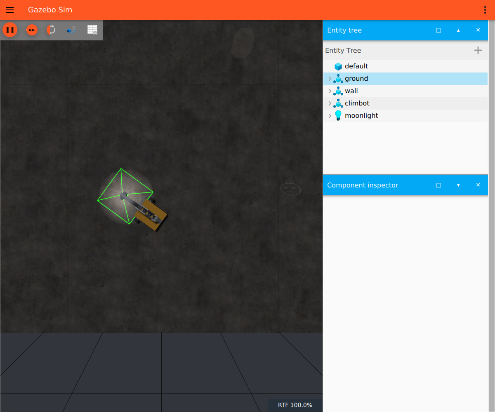
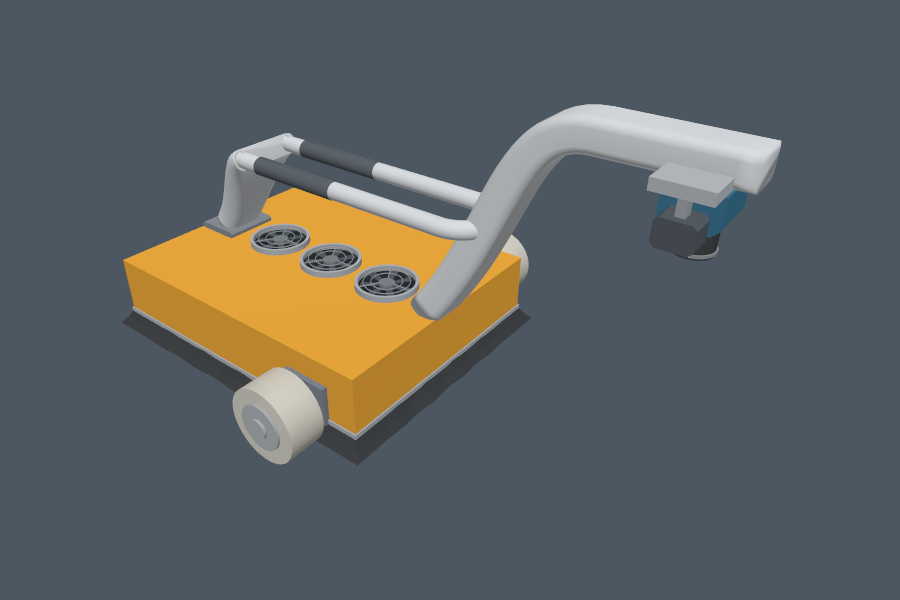
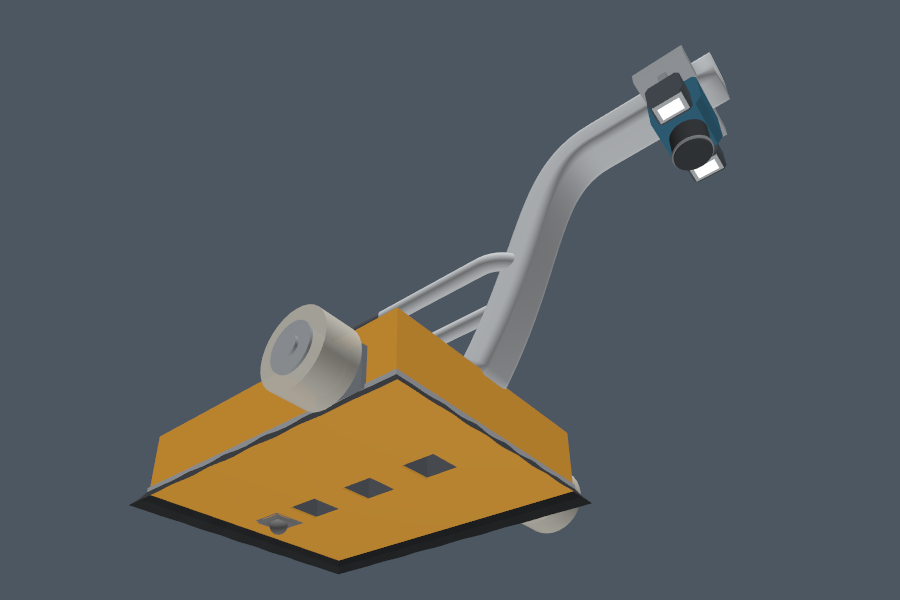

# Climbot Sim

基于 ROS 2 Jazzy 与 Gazebo Harmonic 的垂直壁面爬壁机器人仿真。系统保留真实重力，由三个
固定档位风机对同一底部腔体持续抽气，结合柔性密封圈形成负压贴墙。覆盖规划、直线闭环控制、
位置触发采集、离线图像处理和全局墙面拼接均在本仓库内完成。控制不依赖 Nav2，拼接算法不读取 Gazebo 真值或墙面纹理。

底盘外观近照（M1 阶段 Gazebo 截图，点击可放大）：

| 风扇出风口与上部结构 | 底部密封圈与吸气通道 |
| --- | --- |
|  |  |

主动轮采用偏暖乳白色，透明度为 4%，轮毂与轮轴为金属灰。底部图是移除墙面遮挡后的静态
外观展示，可看清沿底盘一圈外翻的密封裙边和圈内球轮。

## 你能做什么

- 在 Gazebo 中启动墙面、机器人、传感器、EKF 和 RViz；
- 点选矩形或等腰梯形任务区，执行横向或纵向弓字覆盖；
- 在正式扫描线上自动拍摄原始灰度图，把每张图连同曝光那一刻的融合相机位姿一起原子归档；
- 离线校验归档、平场校正、去畸变、匹配、全局位姿优化和硬切墙面拼接；
- 用诊断墙真值和原尺寸 tile 检查拼接的绝对偏差、接缝和缺陷细节。

A～G4、P1 和 P2 的仿真链路均已完成；P2-06 的门限已由三组数据推导、由一组独立数据检验，
人工复核范围见 [STATUS](docs/STATUS.md)。三风机平墙＋刚性轮模型已完成 S6／S7 验收；
2026-10-20 起默认为 M2：起伏墙（±2 mm、板缝、裂缝）＋预压柔顺轮，巡航 0.30 m/s，里程计含重力蠕滑补偿；
`wall_surface:=flat wheel_compliance:=false` 保留 M1 平墙刚性轮。
2026-10-22 起默认轮胎—墙面有效摩擦系数为 **0.8**：原定 0.7 未过瞬时轮载门槛，
经用户许可按 0.8 完成横纵短任务及回归，见[报告](results/m2_friction_2026-10-22/REPORT.md)。

## 安装与快速启动

1. [安装、依赖、资产生成与完整测试](docs/INSTALLATION.md)：区分原生 Ubuntu 和 WSL2，包含可选 CUDA。
2. [快速启动](docs/QUICKSTART.md)：从仿真、规划、平场标定、采集到离线处理与墙面拼接。
3. [实验与故障处置](docs/OPERATION.md)：批处理、参数变体、诊断和历史复现。

首次使用按前两页顺序完成。代码与数据默认放 Linux 文件系统，照片、录包和大图留在数据根；
图形运行库与相机标定的准备步骤都在安装页，不需要从历史计划中拼凑命令。

## 文档导航

| 需要了解 | 唯一入口 |
| --- | --- |
| 文档职责、归档和写作边界 | [docs/README.md](docs/README.md) |
| WSL D3D12 修复库的构建、复用和验证 | [MESA_SETUP](docs/MESA_SETUP.md) |
| 项目目标、范围、硬约束与规范验收 | [PROJECT_GUIDE.md](PROJECT_GUIDE.md) |
| 包职责、依赖和数据流 | [ARCHITECTURE](docs/ARCHITECTURE.md) |
| 话题、服务、Action、参数、文件格式 | [INTERFACES](docs/INTERFACES.md) |
| 批量回归、参数变体与故障处置 | [OPERATION](docs/OPERATION.md) |
| 当前验收状态与正式证据 | [ACCEPTANCE](docs/ACCEPTANCE.md) |
| 当前项目状态、风险与下一步 | [STATUS](docs/STATUS.md) |
| 起伏墙、真实缝隙与柔顺轮计划 | [SUCTION_M2_PLAN](docs/SUCTION_M2_PLAN.md) |
| 离线拼接设计与门禁 | [MOSAIC_PLAN](docs/MOSAIC_PLAN.md) |
| 隐蔽故障、偶发竞态与排查经验 | [INCIDENTS](docs/INCIDENTS.md) |
| 结果有效性、基线与重生成入口 | [results/README.md](results/README.md) |
| 本地大数据保留与清理规则 | [DATA_RETENTION](docs/DATA_RETENTION.md) |

单个包的参数、边界和测试命令写在各自的 README：
[bringup](src/climbot_bringup/README.md)、
[common](src/climbot_common/README.md)、
[control](src/climbot_control/README.md)、
[coverage](src/climbot_coverage/README.md)、
[description](src/climbot_description/README.md)、
[gazebo](src/climbot_gazebo/README.md)、
[image_processing](src/climbot_image_processing/README.md)、
[inspection](src/climbot_inspection/README.md)、
[interfaces](src/climbot_interfaces/README.md)、
[mosaic](src/climbot_mosaic/README.md)、
[rviz_plugins](src/climbot_rviz_plugins/README.md)。

## 安全边界

Gazebo DiffDrive 会持续执行最后收到的速度命令。系统以速度看门狗作为 `/cmd_vel` 的唯一发布者；
键盘、自动控制和脚本统一向 `/control/cmd_vel` 发布，运行时只能启用一个上游控制源。ROS 的受控
停车不等同于实机硬件急停；硬件的失效关闭链路和实机门限都在本项目范围之外，尚待验证。

## 许可

Apache License 2.0，见 [LICENSE](LICENSE)。
