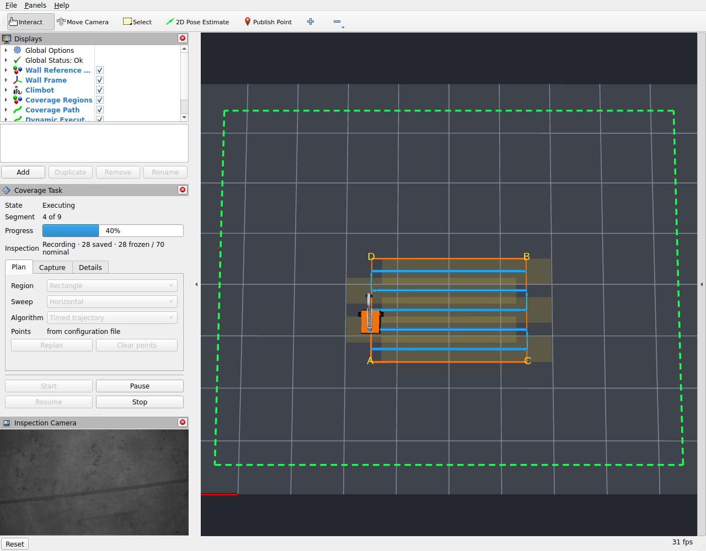
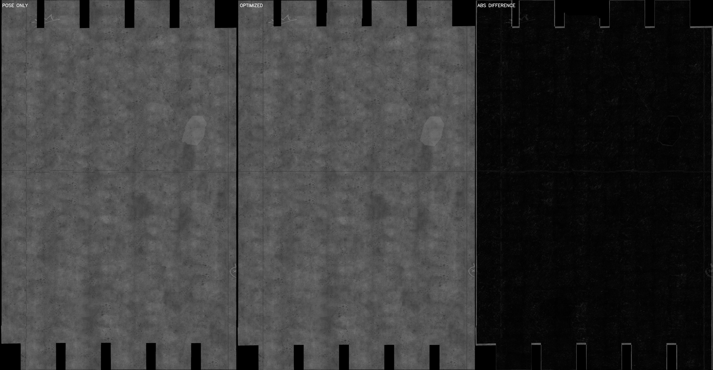

# 快速启动：仿真到墙面拼接

前置条件见[安装与资产准备](INSTALLATION.md)。

## 快速启动

以下命令均假定已经完成构建，并在一个终端执行过：

```bash
source /opt/ros/jazzy/setup.bash
source ~/robot_ws/climbot_sim/install/setup.bash
```

### 1. 只看仿真

默认是新底盘、三风机单腔负压、起伏墙（±2 mm、板缝和裂缝）和预压柔顺轮。风机从环境压启动，
压力就绪后自动撤除安装支撑。轮胎—墙面有效摩擦默认为 0.8；显式 `traction_mu:=1.1` 可复核旧摩擦工况。
`wall_surface:=flat wheel_compliance:=false` 选择 M1 平墙和刚性轮几何。
首次启动起伏墙会生成整墙表面资产（约 2 分钟），之后读取校验过的缓存。想先确认机器人、墙面和传感器是否正常，运行：

```bash
ros2 launch climbot_gazebo climbot_wall.launch.py
```

没有图形界面时，改用无窗口模式：

```bash
ros2 launch climbot_gazebo climbot_wall.launch.py headless:=true
```

### 2. 规划预览

想先画出覆盖路径但不让机器人动，运行：

```bash
ros2 launch climbot_bringup coverage_sim.launch.py
```

随后在 RViz 选择 `Publish Point`，点击任务区域：矩形点左下和右上两个角；等腰梯形再点右下角。
所有点都必须在绿色安全框内。此模式只显示路径，不会控制机器人。

### 3. 首次使用：生成本机平场标定

历史验收使用的 NPZ 不随 Git 分发。新电脑需用同一 PBR 材质路径的均匀靶重新标定，
不能把仓库里的中性靶 PNG 当作平场增益文件。先关闭已有仿真和采集进程，打开三个终端；
每个终端先加载本工作区，并设置同一个数据根：

```bash
source ~/robot_ws/climbot_sim/install/setup.bash
export CLIMBOT_DATA_ROOT="${CLIMBOT_DATA_ROOT:-$HOME/climbot_data}"
```

终端 A 启动标定靶并保持运行（WSL 的 headless 仍需上述 Mesa 补丁）。标定靶装在平墙上，
起伏墙会拒绝它；平场属于相机和灯光，平墙标定同样用于起伏墙采集：

```bash
ros2 launch climbot_gazebo climbot_wall.launch.py \
  headless:=true inspection_flat_field_target:=true wall_grid_spacing:=0 wall_surface:=flat
```

终端 B 启动单次采集服务并保持运行：

```bash
ros2 launch climbot_inspection inspection.launch.py \
  use_sim_time:=true automatic_capture:=false archive_recorder:=false
```

终端 C 采集 30 次独立曝光，成功应输出 `CALIBRATION_OK`，帧数、唯一时间戳和唯一图像均为 30：

```bash
ros2 run climbot_inspection calibrate_flat_field --ros-args \
  -p use_sim_time:=true \
  -p output_file:="$CLIMBOT_DATA_ROOT/calibration/flat_field_local.npz"
```

成功后用 Ctrl-C 结束 A、B，再运行下一节的正常采集任务。新标定的哈希不同于历史验收文件，
离线处理主线显式用 `--allow-unpinned-flat-field` 处理，并在处理清单中记录实际哈希；这不代表它已经
取得历史验收的亮度残差结论。若相机、灯光或曝光改变，需要重新标定。

### 4. 规划、控制与自动采集

想让机器人执行路径并保存巡检照片，先设置数据保存位置，再启动完整任务：

```bash
ros2 launch climbot_bringup coverage_mission.launch.py
```

在 RViz 的 **Coverage Task** 面板中完成点选后按 **Replan**，确认 `Capture` 页显示的是管理器从
launch 参数、`CLIMBOT_DATA_ROOT` 或 `$HOME/climbot_data` 解析出的保存目录，再按 **Start**；手动
修改该输入框只覆盖从这个面板启动的任务，不修改环境变量。机器人只会在直线扫描段拍照。完成后，
保存目录下会出现一个新的任务目录，
其中包含原始图像、每张图的拍摄位姿、相机标定和 `manifest.json`。想让它停一下再接着跑，按
**Pause**，恢复按 **Resume**——任务和归档都不会因此结束；确定不跑了才按 **Stop**。



图中是 M1／S7 阶段实际运行的 3×2 m 任务：5 条扫描线、70 张照片。RViz 同时显示墙面、参考网格、
绿色安全边界、扫描路径和实时相机；Gazebo 右下角显示瞬时 RTF。正式性能要求是在两个 GUI
同时打开并正常采集时，完整任务平均实时率 ≥0.95，图中历史 M1 任务实测 0.98845；
当前 M2 的独立证据见[状态页](STATUS.md)。

改成纵向扫描：

```bash
ros2 launch climbot_bringup coverage_mission.launch.py sweep_direction:=vertical
```

采集任务默认加载新版诊断墙；无 GUI 批处理和 realistic 定位等实验用法，见
[OPERATION 的启动变体](OPERATION.md#启动变体)。

### 5. 离线图像处理

照片采集完成后，这一步对原图做校验、平场校正和去畸变，生成拼接可以读取的新目录。`RAW_RUN` 是
上一步生成的任务目录；`PROCESSED_RUN` 必须是一个还不存在的新目录：

```bash
RAW_RUN="$CLIMBOT_DATA_ROOT/<task-id>/<run-id>"
PROCESSED_RUN="$CLIMBOT_DATA_ROOT/processed-<new-id>"

ros2 run climbot_image_processing process_inspection_archive \
  --input-run "$RAW_RUN" \
  --output-dir "$PROCESSED_RUN" \
  --flat-field-file "$CLIMBOT_DATA_ROOT/calibration/flat_field_local.npz" \
  --allow-unpinned-flat-field \
  --denoise none --jobs auto --memory-budget-gb 4
```

原始照片不会被修改。命令成功后，在 `PROCESSED_RUN` 中得到校正后的图像和对应标签。
使用已核验的历史标定文件时，移除 `--allow-unpinned-flat-field`，保留原有 SHA-256 严格门禁。
明确不做平场校正时，将 `--flat-field-file ...` 与 `--allow-unpinned-flat-field` 两项一并换成
`--no-flat-field`；完整参数见 [image processing README](../src/climbot_image_processing/README.md)。

### 6. 离线墙面拼接

这一步把多张照片拼成一张墙面图。通常把横向和竖向两次采集一起输入：`RUN_H`、`RUN_V` 是上一步
得到的两个 processed 目录；`ROOT` 是本次拼接的目录前缀，下面每一步都在它后面加一个不同的
后缀，作为自己的输出目录。

按顺序执行下面五步。未安装可选 CUDA 后端时，执行最后一步前将 `--backend cuda` 改为
`--backend cpu`。某一步报错时，先看该步输出的错误，不要跳到后面继续运行。

| 步骤 | 命令 | 它在做什么 | 成功后得到什么 |
| --- | --- | --- | --- |
| 0 | `validate_mosaic_inputs` | 检查照片、标签和标定是否齐全、是否匹配 | 终端里的检查结果；不创建目录 |
| 1 | `build_overlap_candidates` | 找出哪些照片拍到了同一块墙 | 候选照片对列表 |
| 2 | `build_local_matches` | 比较重叠部分，估计两张照片之间的细小偏移 | 照片之间的匹配结果；临时缓存可删除 |
| 3 | `build_pose_graph` | 把所有照片的偏移一起调整，让整面墙尽量对齐 | 调整后的照片位置与质量报告 |
| 4 | `build_wall_mosaic` | 把调整前和调整后的照片各拼成一张完整墙面图 | 两张 BigTIFF、预览图、覆盖图和报告 |

第 0、1 两步的产物是给人查阅的记录，后面的命令并不读取它们：第 2 步会用同一套代码自己重算
一遍候选。照做一遍的好处是出了问题能分步定位，也留下可复查的证据。

`build_initial_projection` 同样是可选的检查命令：它画出每张照片预计落在墙上的范围，适合
先看相机方向、比例和任务区域是否合理。正常拼接不必单独运行，因为第 1 步会做同样的计算。

```bash
RUN_H="$CLIMBOT_DATA_ROOT/processed-<horizontal-id>"
RUN_V="$CLIMBOT_DATA_ROOT/processed-<vertical-id>"
ROOT="$CLIMBOT_DATA_ROOT/mosaic-<new-id>"

ros2 run climbot_mosaic validate_mosaic_inputs \
  --input-run "$RUN_H" --input-run "$RUN_V"

# 第 1 步：找出拍到同一块墙的照片对。
ros2 run climbot_mosaic build_overlap_candidates \
  --input-run "$RUN_H" --input-run "$RUN_V" \
  --output-dir "$ROOT-candidates"

ros2 run climbot_mosaic build_local_matches \
  --input-run "$RUN_H" --input-run "$RUN_V" \
  --output-dir "$ROOT-matches" --work-dir "$ROOT-work-match" --jobs auto

ros2 run climbot_mosaic build_pose_graph \
  --input-run "$RUN_H" --input-run "$RUN_V" \
  --local-matches "$ROOT-matches/local_matches.json" \
  --output-dir "$ROOT-pose-graph"

ros2 run climbot_mosaic build_wall_mosaic \
  --input-run "$RUN_H" --input-run "$RUN_V" \
  --pose-graph-dir "$ROOT-pose-graph" \
  --output-dir "$ROOT-hardcut" --work-dir "$ROOT-work-fusion" \
  --resolution-mm-per-pixel 0.25 --jobs auto --memory-budget-gb 4 \
  --preview-max-side-px 4096 --backend cuda
```

上面的命令是本项目 CUDA 开发机的标准拼接测试方式；运行后应检查
`mosaic_manifest.json` 中 `execution.effective` 为 `cuda`，且 `execution.fallback=false`。CLI 默认仍是 `--backend cpu`，
因此普通 ROS 2 机器可把最后一个参数改为 `--backend cpu`。`--backend auto` 会在 CUDA 不可用或运行失败时清理
临时目录并从头改跑 CPU，但不会用回退掩盖输入、哈希或共享磁盘错误。CUDA 只加速第 4 步的
hard-cut 融合，不改变前面的特征匹配和位姿图。

最终重点看两个文件：`mosaic_pose_only.tif` 是直接按拍摄位姿拼出的结果；
`mosaic_optimized.tif` 是经过第 3 步对齐后拼出的结果。两者使用同一批照片，因此可以直接比较。
`coverage_count.tif` 中为零的位置表示相机从未拍到，那些区域不能当作有效墙面图。需要检查诊断墙时，
继续运行[真值评价与原尺寸检查](operations/IMAGE_PIPELINE.md#诊断墙后验检查)。

[](images/mosaic_comparison_full.jpg)

左起分别是 pose-only、optimized 和两者的绝对差值。点开可看原尺寸（7887 × 4096）。差值图上仍然
发亮的位置就是全局优化真正改动过的地方，其余接近全黑说明两条路径在那里本来就一致。

