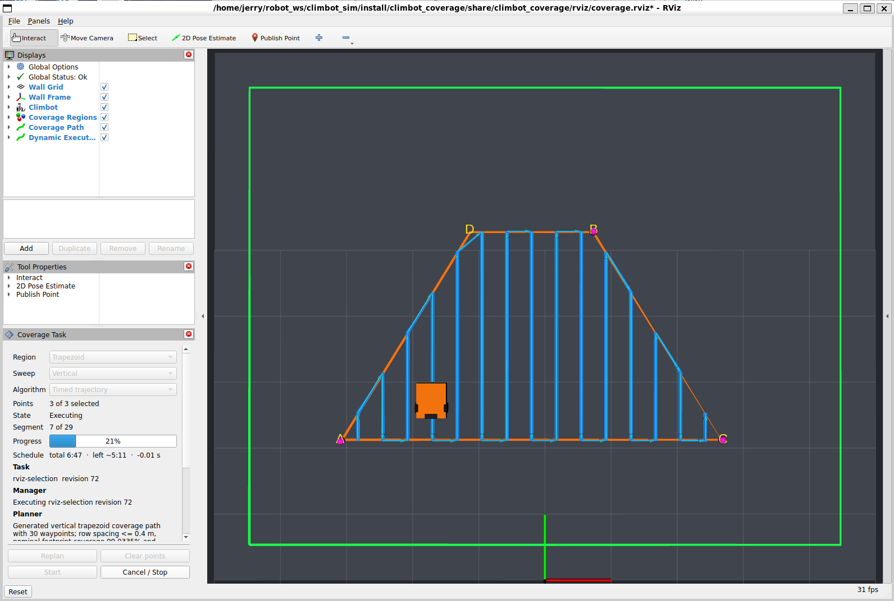

# 历史分册 1

# 操作手册

从零启动一次覆盖任务需要知道的全部内容。包边界和数据流见
[ARCHITECTURE.md](../../../ARCHITECTURE.md)，话题、服务和参数的完整清单见
[INTERFACES.md](../../../INTERFACES.md)，安装与构建见
[README](../../README.md)。

以下所有命令都假定已经 source 过环境：

```bash
source /opt/ros/jazzy/setup.bash
source install/setup.bash
```

## 只看仿真

启动墙面、机器人、传感器和 EKF：

```bash
ros2 launch climbot_gazebo climbot_wall.launch.py
```

WSL2 默认自动使用 Mesa D3D12 GPU 后端。自动检测不符合当前环境时可以指定：

```bash
ros2 launch climbot_gazebo climbot_wall.launch.py gpu_backend:=wsl_d3d12
```

Gazebo 的物理／传感器 server 与 GUI 是独立进程：GUI 因 WSLg OpenGL context 创建失败而退出时，
仿真和 ROS 节点仍继续运行；可在修复显示环境后单独执行 `gz sim -g -v 3` 重新连接。只有
server 退出才会受控关闭整套 launch。标准 launch 还会以独立进程组监督两个 Gazebo 客户端；
Ctrl+C 先由监督器接收，再以 `SIGTERM` 结束整个客户端组，避免 GZ 8/Ogre 直接处理 `SIGINT`
时崩溃，或 Ruby 启动器退出后遗留真正的 `gz sim` 子进程。

本仿真默认是**夜间、弱月光环境**：一束 `lighting.moonlight`（强度 `0.30`）提供真实、
可投影阴影的月光；机器人支架 LED 是更强的相机主照明。两者均是实际场景光，相机也会看到，
因此 G3/G4 图像验收应记录其数值，修改后须重新生成平场标定，不能把它误认为纯 GUI 显示设置。
相机视锥已验证不含机器人、支架或灯具；仍须通过带贴图实拍确认平整墙面的正常原图不出现可见
阴影。世界还带有位于墙脚下方 20 mm 的静态中性灰地面，供操作者观察空间关系；它不会改变墙面
上的轮子接触。

键盘控制在另一个终端运行：

```bash
ros2 run teleop_twist_keyboard teleop_twist_keyboard --ros-args \
  -r /cmd_vel:=/control/cmd_vel \
  -p speed:=0.15 -p turn:=0.8
```

机器人初始朝墙面水平方向。水平行驶时应在重力作用下逐渐下降，停车后由静摩擦
基本保持高度。

只要预览规划、不需要执行：

```bash
ros2 launch climbot_bringup coverage_sim.launch.py
```

使用独立规划器或等腰梯形的命令见
[climbot_coverage/README.md](../../../../src/climbot_coverage/README.md)。

## 完整任务：点选区域并执行

一条命令启动仿真、规划器、RViz、跟踪器和任务管理器：

```bash
ros2 launch climbot_bringup coverage_mission.launch.py
```

上述两个 bringup 入口默认同时启动 G1 相机单拍服务。RViz 的 Displays 中
`Inspection Camera` 保持订阅，调用一次：

```bash
ros2 service call /inspection/capture_once climbot_interfaces/srv/CaptureOnce '{}'
```

成功响应（`success: true, reason: 0`）表示一对同时间戳的畸变原图和 `CameraInfo` 已发布，
不只是触发消息已发出。临时状态用稳定的 `reason` 枚举报告：预热 `1`、忙 `2`、排空迟到帧
`3`、本次超时 `4`；不要依赖返回文案。`/inspection/capture_reset` 可人工重新开始排空期，
但不会绕过排空而立即曝光。
相机空闲时不连续出图。只做非视觉调试可在 launch 后加 `inspection:=false`；拍墙面
纹理时还应加 `wall_grid_spacing:=0`。

正式相机图像编码为 `mono8`。默认视觉场景是弱环境光加支架上的单 LED 射灯，原始图
应当中心较亮、四角平滑变暗，但整幅图内不能看见光锥硬边或机器人结构；当前光心
外参为 `[0.340, 0.000, 0.275] m`。彩色 Ogre2 帧只在仿真内部用于材质和光照计算，
不得作为巡检业务图发布。

提交含真实相机足迹的覆盖任务后，自动采集节点会在每条正式 SCAN 上按相机中心的
实际沿轨位置触发，不依赖时间表。每张图在 `/inspection/capture_metadata` 发布同时间戳
的任务 ID、版本、段号、触发号、曝光时刻相机融合位姿和墙面航向。有效足迹为
`0.500 × 0.28125 m`；横向扫描带的 `overlap_ratio` 与纵向拍照的
`image_overlap_ratio` 是两个独立参数，默认均为 `20%`。因此名义横向行距为
`0.400 m`，纵向触发间距为 `0.225 m`。G2 实际重叠验收下限为 `15%`，即纵向曝光
中心间距不超过 `0.2390625 m`、横向扫描中心线间距不超过 `0.425 m`；实际间距仍会
被记录并验收。
每条正式扫描线冻结后，系统以该线实际长度 `L` 和间距
`s = detection_length × (1 − overlap)` 生成 `ceil(L / s)` 个位置触发点；最后一点
保留在终点前一个间隔内，避免控制器在终点容差内完成而漏掉理论端点帧。记录器使用同一
冻结参考和同一公式核对归档数，名义规划航点数量只用于任务开始前的磁盘容量预留。
因此 Capture 页会同时显示：**Nominal**（开始前的全任务容量预估，任务期间不变）和
**Frozen**（已实际冻结的 SCAN 参考累计拍摄计划，第一条扫描线后从零开始逐条增长）。
例如 `22 frozen / 132 nominal` 不是任务缩短为 22 张，而是 132 张任务中目前只有首条线的
22 张已按实际执行参考确定；全部扫描线冻结后 Frozen 才是最终必须与已保存数严格相等的数。
巡检与普通覆盖任务均使用 `0.20 m/s` 巡航。全站仪默认仍为 12 Hz、1 mm 噪声和 10 ms
固定传输延迟；由此产生的曝光位姿误差保存到标签并由离线拼接处理，不通过在线限速掩盖。

轴向验收时可临时显示非对称靶；正常巡检不要打开：

```bash
ros2 launch climbot_gazebo climbot_wall.launch.py \
  inspection_target:=true wall_grid_spacing:=0 headless:=true
```

红色块表示机器人前进正向，应出现在图像上方；绿色块表示墙面向上，应出现在图像
左侧；蓝色块是投影中心。靶标默认关闭，不会混入普通墙面图像。

### 弱光平场标定

先以纯灰板启动仿真和巡检单拍节点，再采 30 张独立曝光：

```bash
ros2 launch climbot_gazebo climbot_wall.launch.py \
  headless:=true inspection_flat_field_target:=true wall_grid_spacing:=0
ros2 launch climbot_inspection inspection.launch.py \
  use_sim_time:=true automatic_capture:=false
ros2 run climbot_inspection calibrate_flat_field --ros-args \
  -p output_file:=/tmp/climbot_flat_field.npz -p frame_count:=30
```

成功日志必须同时显示 `frames=30 unique_stamps=30 unique_hashes=30` 和非零
`noise_dn`。正常纹理墙重启后，通过
`inspection.launch.py flat_field_file:=/tmp/climbot_flat_field.npz` 发布
`/inspection/camera/image_compensated`；原图仍保留。曝光、LED、相机或镜头参数改变后
必须重新标定。`simulation.inspection_camera.exposure_scale` 是 Gazebo 没有原生曝光控制时的
相对积分时间（仅允许不大于 1 的短曝光）；标定会拒绝饱和像素比例超过 `0.01%` 的原始灰板帧。

完整任务可直接传入持久化标定文件；它只发布补偿预览并写入归档的标定引用，`images/raw/`
仍是未经畸变或光照补偿的原始帧：

```bash
ros2 launch climbot_bringup coverage_mission.launch.py \
  flat_field_file:="$CLIMBOT_DATA_ROOT/calibration/<flat-field>.npz"
```

仿真默认纯灰板目标均值为 `172.75 DN`；它在当前 LED／短曝光组合下复现混凝土补偿图约
`86 DN` 的既有亮度，并保留高亮余量。可用 `-p target_mean_dn:=...` 调整，范围为 `1～254 DN`。

### 点选机器人任务可走区

RViz 从启动起显示**绿色虚线框**，它是墙面按机器人安全边距内缩后的绝对安全区。
用户点击的矩形或等腰梯形表示机器人执行扫描时的名义可走区，而不是必须完整拍到的墙面
目标；任一点或自动补出的梯形顶点落在绿框外都会被拒绝。

工作系的原点在墙面左下角，所以坐标全是非负的：`10 × 8 m` 的墙面配上
`safety_margin = 0.5 × hypot(0.76, 0.475) + 0.10 = 0.548 m`，绿色虚线框就是
`x ∈ [0.548, 9.452]`、`y ∈ [0.548, 7.452]`，机器人出生在 `(5.0, 2.0)`。

完成点选后，橙色实线显示任务可走区，蓝色实线显示完全位于橙区内的机器人中心路径，
黄色半透明带显示相机预计扫掠覆盖。黄色由蓝线、`0.340 m` 前置外参和
`0.500 × 0.28125 m` 有效视场计算，可能伸出橙区，也可能因交替扫描和梯形斜边呈不规则
边缘。启动未规划时没有黄色，因为那时还没有扫描线可供推导。

墙面上和 RViz 里都画着 `1 m` 的**参考网格线**。线落在工作坐标的整数倍上、只画
内部线，两个视图用的是同一条规则和同一个间距（`climbot_description/config/wall.yaml`
的 `reference_grid.spacing_m`），所以从任一视图读出来的坐标一致。

两套网格各有各的开关，互不影响：

| 要关的 | 怎么关 |
| --- | --- |
| **Gazebo 墙面上那套**（会进照片） | 启动时加 `wall_grid_spacing:=0` |
| **RViz 叠加层**（只有人看） | Displays 里取消勾选 `Wall Reference Grid`，当场生效 |

```bash
ros2 launch climbot_bringup coverage_mission.launch.py wall_grid_spacing:=0
```

`wall_grid_spacing` **只管墙面那套**，不碰 RViz。拍摄墙面的运行必须加它——网格线是
周期性高对比特征，还浮在墙面前 `3 mm`，在 `0.50 × 0.28 m` 的拍摄视场下会进入 `67%`
的照片。而这类运行操作员照样要看规划，所以 RViz 那套不能跟着一起消失。

在工具栏选择 `Publish Point`，按下表顺序点击角点。每次点击 `/coverage/status`
都会回显它认成了哪个角和坐标，用来确认没有因为相机视角而选反方向：

| 区域 | 点击顺序 |
| --- | --- |
| `rectangle`（默认） | A 左下 → B 右上 |
| `trapezoid` | A 左下 → **B 右上** → C 右下 |

梯形第二下是右上、第三下才是右下，容易顺手点成逆时针。手点两个底角不可能等高，
规划器会取均值，差超过 `bottom_warning_tolerance`（默认 `50 mm`）时状态里会多一句
`Bottom clicks differed by ... and were corrected to their mean height.`，这是提示
不是错误。

最后一次点击后 RViz 中出现规划路径，左侧 **Coverage Task** 面板的 State 变为
`Ready` 并显示任务名与 revision。

### 面板



面板上方公共区始终显示 State、Segment、Progress 和 Inspection 摘要；中间页签分别为
`Plan`、`Capture`、`Details`，底部的 Start 与停车按钮不随页签滚动。

| 页签／行 | 内容 |
| --- | --- |
| **Plan** | Region、Sweep、Algorithm、点选状态、Replan 与 Clear points |
| **Capture** | 本次任务的原图归档开关、记录器端根目录、名义总预计／已冻结实际计划／已保存／失败数量、最终目录和归档状态 |
| **Details** | Task、Schedule、Manager、Planner 与 Last request |

| 按钮 | 作用 |
| --- | --- |
| **Start** | 开始执行，State 转为 `Executing` |
| **Cancel / Stop** | 中途停车 |
| **Force abandon** | 仅在 Start 应答永久未知时才显示；5 秒内二次点击后进入恢复锁，不代表任务已停止 |
| **Rearm after verification** | 仅在恢复锁时显示；确认硬件急停、驱动失能、执行器确已终止，或 hold 解除等待已安全收回后解除恢复锁 |
| **Clear points** | 点错角点时清空重选 |
| **Replan** | 用当前角点重新规划 |

**任务运行期间，Plan 页的五个规划控件以及 Capture 页的开关和根目录全部置灰。**
正常运行中只保留 Cancel；仅在异常恢复状态才显示并开放 Force abandon 或 Rearm。这些规划
控件发出的请求确实只改预览、不动正在执行的 Goal，但预览就是画在机器人身上的那条轨迹，
运行中改它看起来就像任务被换掉了。

Start、Cancel、Force abandon 和 Rearm 的置灰由管理器发布的许可位决定；恢复锁和
运行期间五个规划控件都置灰，不是面板另外判断一遍任务状态。无论面板显示什么，
非法请求都由管理器拒绝，原因显示在 Last request 一行。

