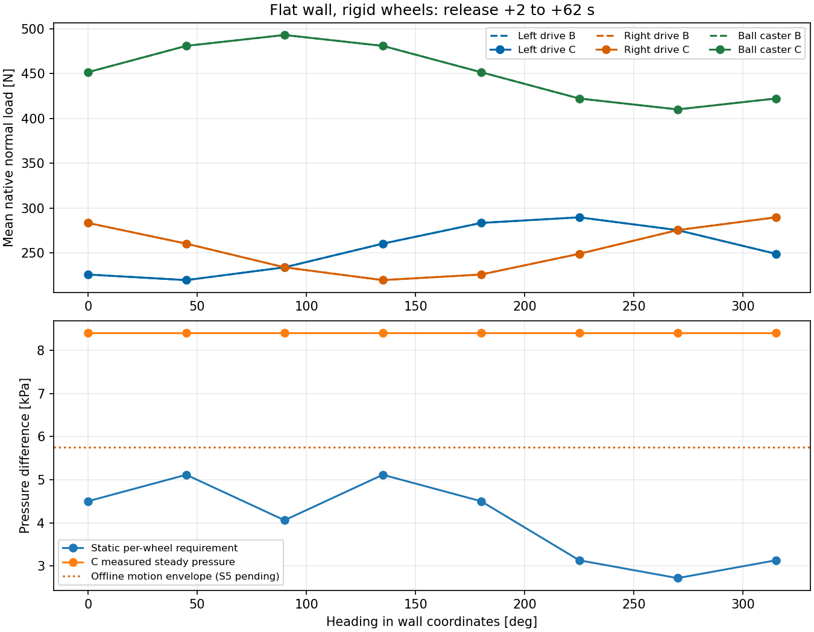

# S3 平墙负压集成与独立轮载验证

日期：2026-10-17。范围为 M1 的平墙、刚性轮、三风机共用单腔与等效裙边。
**S3 通过：19 个原生 Gazebo 工况、231/231 项预注册检查及 3 项原始数据复核通过。**
该结论覆盖安装启动、静止保持、实际施力、暂停/reset 和稳态步长收敛；不代表运动、压力
传感器、故障扫描、完整采集或 M2 起伏／柔顺轮已经通过。曲线与材料均为 provisional。

## 版本、运行环境与复现

- 原生模型／插件／记录器及预注册方法：提交 `9a51f50`，生成时 tracked 工作树干净。
  [源清单](source_manifest.json)记录源文件、原生程序摘要及 12 个 S0 运行输入逐字节不变。
- [二进制身份](binary_identities.json)另记实际插件和记录器 SHA-256。补齐 NumPy 包依赖
  后重新构建，两项二进制摘要保持不变；不以当前分支 HEAD 冒充原生实验代码版本。
- 测试发现屏障修正：`b22ce24`、`fe3cc38`；这些只修改测试夹具，不修改运行控制器、
  采集节点或原门槛。记录器 reset 修复包含在 `9a51f50`。
- WSL D3D12 使用本地修复 Mesa 25.2.8，Gallium SHA-256 为
  `f2c80fbfb37a73aab1e4b94cf95bc862f271cd30055573c6196b9073cc4d6d66`。
  每个原生进程的 `runtime_libraries.json` 均确认四库来自所选私有目录、无系统 Gallium。
  这批明确关闭相机及渲染 Sensors；没有将无 GUI 当作关闭 GPU，也不将其写成成像验收。
- 本机私有参考问题记录来自 4W `eaa576e` 与轨道车 `cf5cfbd`，涉及 Mesa 缓存泄漏、
  Gazebo 退出、网格边缘异常接触、柔顺轮和接触记录；它们不作为可移植运行依赖。

入口与物理方法见 [S3 方法](../../docs/SUCTION_S3_METHOD.md)。加载 ROS 与本工作区后：

```bash
ros2 launch climbot_gazebo climbot_vacuum.launch.py
python3 tools/validate_vacuum_sim.py --output results/另一个全新目录
python3 tools/audit_vacuum_sim.py results/另一个全新目录
```

新入口是专项物理入口，旧默认 launch 保持冻结。B 使用 `pressure_mode:=fixed_pressure`。
默认 WSL 选择补丁 Mesa，校验失败明确退出；软件／系统库仅作显式对照。8 秒真实 launch
检查中服务器、桥接和状态发布存活，随后正常退出 0；日志 `climbot_s3_launch_native_20261017.log`
保留在临时日志目录，没有把它扩大为相机、GUI 或长采集验收。

## 冻结条件与施力

| 项目 | 本批条件 |
| --- | --- |
| 结构 | 426.5×342×85 mm；圈外两驱动轮；圈内球轮 x=-0.300 m；20 mm 接触带 |
| 质量／重心 | 14.86970405 kg；(-0.07532433, 0, 0.08540948) m；原生质量与离线值一致 |
| 几何 | 轮距 435 mm、驱动轮半径 47.5 mm；有效受压面积 0.131293 m² |
| 压力源 B | 同一插件理想固定压差 8404.442641 Pa；从环境压力初始化，首步由理想源建立压差 |
| 压力源 C | S2 冻结的三机固定档位＋容积 ODE；每台关断压差 14 kPa，互不叠加 |
| 漏气 | 残余 20 mm²＋受控 2×80 mm²；总 180 mm²；未按本次结果重调风机 |
| 裙边 | k=5000 N/m、d=40 Ns/m、自由高 22 mm、法向行程 10 mm；β=0.5、滑动 μ=0.1 |
| 轮系 | 原生刚性接触；驱动 μ=1.1；球轮 μ=0.35，连续滚阻系数 0.01、正则化 1 mm/s |
| 时间 | 主物理步 1 ms；压力最大子步 50 μs；45° C 另测 0.5 ms |
| 安装支撑 | 重心补偿重力＋压力中心向墙预压 80 N；门槛 1.05×逐轮静态要求，连续 0.5 s；10 s 超时保留支撑 |
| 验收窗口 | 撤除首步起检查接触与逐轮要求；稳态固定取撤除后 2～62 s，整段 60 s |

B/C 只有压力源不同，世界生成契约测试逐项核对。压力只通过一次带 offset 的世界外力
作用于实际压力中心；裙边无重复碰撞，原生三轮与硬壳仍参与物理接触。释放后六维夹具
施力严格为零。额外注入旧 ApplyLinkWrench 的[负对照](mutual_guard/guard_summary.json)
明确拒绝并退出 2，错误为 `vacuum and ApplyLinkWrench are mutually exclusive`。

## 按实际载荷分配修订吸力预算

侧向静止实测两驱动轮切向载荷接近均分，不能仅沿用 S1 的“按法向载荷比例分配”。新启动
预算同时检查均分与比例分配的摩擦圆。历史结果不覆盖，新的[重算结果](revised_design.json)
及逐航向记录另存；两种分配的包络仍不是任意未知分配的严格上界。

| 口径 | 名义运动包络最低压差 | 压力合力 | 最不利瞬时状态 (航向°, v, a, ω, α) |
| --- | ---: | ---: | --- |
| 原 S1 比例分配 | 5591.856 Pa | 734.172 N | (49.9, 0.189, 0.7, -1.2, 0) |
| 均分及两假设包络 | 5756.200 Pa | 755.749 N | (41.8, 0, 0.7, -1.2, 0) |
| 向上取整设计检查点 | 5800 Pa | 761.499 N | 100 Pa 档向上取整 |

共 149 个瞬时运动剖面，1° 全航向扫描、各剖面峰值附近 0.1° 细化，重力 9.81 m/s²。
这是修订的离线运动预算，尚须 S5 实际行走验证；不能称为整车动态验收。400 N 没有作为
设计输入倒推。S2 已知不利参数端点不能被当前风机工作点覆盖，仍保留失败边界，未据名义
静止通过宣布所有未知质量／摩擦／裙边组合可行。

## 八朝向原生轮载

下表为 C 的稳态均值。B 的各轮均值与 C 最大差 0.001664 N；全部 16 个主工况均满足
原合同的样本、接触、逐轮载荷／裕量与平衡条件。

| 航向 | 左驱动 N | 右驱动 N | 球轮 N | 该航向静态最低压差 Pa | 从释放起最小实测摩擦裕量 | C 释放时刻 s |
| ---: | ---: | ---: | ---: | ---: | ---: | ---: |
| 0° | 225.879 | 283.444 | 451.669 | 4500.08 | 3.157 | 0.711 |
| 45° | 219.627 | 260.332 | 481.032 | 5113.85 | 2.722 | 0.744 |
| 90° | 233.898 | 233.898 | 493.195 | 4058.08 | 3.447 | 0.689 |
| 135° | 260.332 | 219.627 | 481.032 | 5113.85 | 2.722 | 0.744 |
| 180° | 283.444 | 225.879 | 451.669 | 4500.08 | 3.157 | 0.711 |
| 225° | 289.698 | 248.992 | 422.301 | 3128.50 | 3.564 | 0.650 |
| 270° | 275.427 | 275.427 | 410.137 | 2715.45 | 4.037 | 0.633 |
| 315° | 248.992 | 289.698 | 422.301 | 3128.50 | 3.564 | 0.650 |



主工况每段 64000 个物理样本、60000 个稳态样本；半步长为 128000／120000 个。
释放后无缺失／断触，驱动轮≥5 N、球轮≥10 N，按修订静态要求计算的最小逐轮法向余量
97.52 N。C 稳态压差约 8404.443 Pa，对应压力合力 1103.444 N；工作点距 14 kPa 关断
压差约 40%，这个余量与裕量 1.5 是不同概念。

全主工况：稳态合力均值残差向量模最大 5.02e-7 N；世界原点力矩均值残差模最大
0.000471 Nm，均低于原合同 2% 门槛。60 s 积分线／角动量残差模最大
3.02e-5 Ns／0.02826 Nms，非零值原样保留。整车 P/H 独立汇总原生惯量、姿态和速度，
未用需求模型替代轮压，也未拟合原生接触力缩放量。最大释放后轮压预测瞬时偏差
4.726 N 出现在 B 的释放过渡，不能用稳态均值隐藏该差异。

稳态最大位置变化 0.0761 mm；不宣称严格零运动。最小底面间隙 17.9982 mm，释放后裙边
最大间隙差约 1.794 μm，无持续倾斜或底板穿墙。记录器合计保存 1,167,500 个非暂停
物理样本、5,837,949 个原始接触点。全批接触法向偏离平墙法向最大 0°，两侧力之和误差
0 N；最大原生接触穿入 0.08090 mm，发生于 B 的启动窗口，保留该数值，不将刚体接触
求解的微小穿入当作新增柔性轮模型。

本机主工况插件计算平均最大 73.18 μs、P99 最大 146.19 μs；测量期部分并行跑回归，且
关闭成像，因此这些是本次观测开销，不能外推完整相机／控制链路实时率。

## 步长、暂停、reset 与失败工况

- 45° C 的 0.5 ms／1 ms 稳态压差差 0.0000613 Pa，三轮均值差最大 0.000362 N，
  均满足预注册 2% 条件。它不替代 S2 快速开口瞬态收敛或 S5 动态收敛。
- 100 次暂停迭代中，首个后端缓存刷新单独报告为 0.201872 μm／1.42114 μrad。
  其余 99 次逐项检查全部 CSV 标量精确相等，压力／转速／就绪状态无推进；没有放宽
  姿态容差把边界刷新隐藏。原始 ECM 联系到同一步 iteration／sim time，原生 header
  未填充而为零，未冒称 ROS 传感器话题时间戳已验证。
- reset 恢复环境压力、零转速、夹具有效、释放时刻 -1，清空就绪与失败并递增代次。
  两个代次都观察到完整运行，重新启动后撤除支撑；生命周期工况 5000 个有效物理样本。
- 固定 100 Pa 的 10.5 s 工况如期在 10 s 启动超时；夹具始终有效、从未释放，
  `startup_failed=true`、`runtime_failed=false`。这是通过失败处理检查，不是低压正常保持通过。
- [逐项摘要](s3_summary.json)、[主检查](validation.json)、[原始审计](raw_audit.json)保留
  细节；每个目录含 resolved 输入、请求、世界／模型／URDF、逐物理步压缩 CSV 和进程结果。

## 诊断失败、修正与完整回归

先导失败均不当作通过证据，完整日志留在临时日志目录；本批由修正后干净提交重新运行：

1. 最初从 sensor 实体读取接触，支撑就绪始终不成立；原生数据实际在 collision，
   改为逐物理步读真实碰撞数据后重新验证，未改成预测轮压。
2. 暂停首迭代姿态变化和 reset 观测失效分别定位为 Gazebo 缓存刷新、TestFixture
   内存系统缺少 `ISystemReset`；后者先导曾退出 134。改用自有可 reset 观测系统，
   回调异常明确报失败，最终严格审计通过，见 [问题 19](../../docs/INCIDENTS.md)。
3. 首次 64 s 先导因记录器符号链接解析到 build、错误推导插件路径，插件未加载，
   随后空状态访问退出 -11。修正为 ament 包前缀找库，并显式拒绝空观测，不把它当作
   物理仿真有效；下一先导物理通过后，摘要曾因 NumPy bool 序列化失败，修正严格 JSON
   类型后才提交并重新开始本批。临时先导没有冒充正式数据。
4. 初始 -j8 归档夹具一次 Start=false 未记录具体响应；后补响应仍未自然复现同一拒绝，
   不能宣称已定位某个端点。核对缺少管理器依赖发现屏障后，只等待两种明确、尚未派发
   预检或 Goal 的 unavailable 拒绝，增加 3 项确定性回归，其他失败仍立即报错。
5. 6 次串行诊断的最后一轮还发现采集“无心跳”测试收到 6 条先前 segment=13 消息。
   修正可靠匹配后过量重发参考造成的排队，保留严格空列表断言，见
   [问题 20](../../docs/INCIDENTS.md)。另有一次诊断脚本与同域单项测试重叠，已终止并
   排除，不作为产品故障或通过证据。

最终在两项夹具修正及依赖重建后，连续两轮
`colcon test --executor parallel --parallel-workers 8` 均为 **1554 tests、0 errors、0 failures、
74 skipped**；所有跳过来自现有 cppcheck 性能规则，功能和原生测试实际运行。源与日志名
见[回归记录](regression_validation.json)。两次最终日志为
`climbot_s3_final_after_capture_{0,1}_20261017.log`；完整内容不提交。
旧巡航 0.210464 m/s 超过 0.205 m/s 的 S0 观测直接原因仍未定位，最终绿色不关闭该项。

## 后续边界

下一步 S4：腔压测量与物理真值分离、噪声／延迟／时间戳、三机独立启停与可重复故障注入、
ROS bridge。S5 验证实际运动、逐时刻需求、停转倒灌及漏气失压；S6／S7 才验完整任务与
最终默认入口。M2 的小起伏随形、深沟槽、柔顺轮及其状态链另行验收。S2 的故障曲线与
不利端点、旧速度观测继续保留，不能由本批静止结果覆盖。
